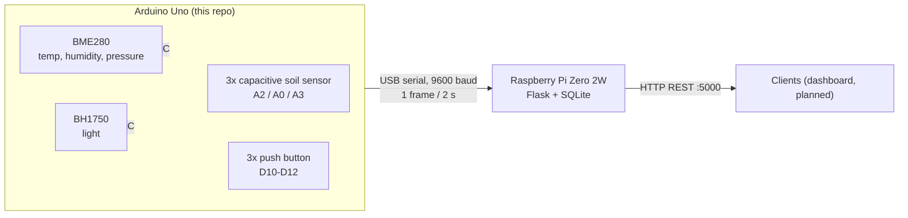

# greenhouse_v1 — Smart-Greenhouse firmware

Arduino Uno firmware for a small balcony greenhouse (basil, lettuce) with three
planting compartments. It reads the sensors, smooths the soil-moisture signal and
streams one text frame every 2 s over USB serial to a Raspberry Pi, which stores
the readings and serves them over a REST API.

Architecture, contracts and decisions live in the companion repo
[`greenhouse-specs`](https://github.com/FabianGlueck/greenhouse-specs).



## What it does today

- **Soil moisture, three compartments** (left `A2`, middle `A0`, right `A3`):
  raw ADC value, a 10-sample moving average, and a percentage mapped from a
  dry/wet calibration (`DRY_RAW = 500`, `WET_RAW = 330`, shared by all three
  sensors for now).
- **Climate and light**: BME280 (auto-detected at `0x76` or `0x77`) and BH1750.
- **Graceful degradation**: an I2C scan at boot; a missing BME280 or BH1750 is
  reported and its fields are simply left out of the frame.
- **Buttons** on `D10`–`D12` (debounced via ezButton) light the external LED on
  `D8` and log press/release events.
- **No dynamic allocation** in the loop — fixed buffers only (the Uno has 2 KB SRAM).

## Serial frame

One line every 2 s (values illustrative):

```
Soil_L RAW:431 SMOOTH:428 Moist%:42 | Soil_M RAW:...  | Soil_R RAW:... | Temp:22.4C Humid:55.1% Press:1013hPa | Lux:830
```

The `Temp`/`Lux` segments appear only when the sensor was found at boot. Boot
messages and button events go to the same port, so the receiver parses frame
lines and skips everything else. The contract is documented in
[`greenhouse-specs/contracts/serial-protocol.md`](https://github.com/FabianGlueck/greenhouse-specs/blob/main/contracts/serial-protocol.md).

## Hardware

| Part | Pins |
|------|------|
| Arduino Uno | — |
| 3x capacitive soil-moisture sensor | `A2` (left), `A0` (middle), `A3` (right) |
| BME280 | I2C (`A4`/`A5`) |
| BH1750 | I2C (`A4`/`A5`) |
| Relay input | `D9` (initialised off; not switched yet) |
| External LED | `D8` |
| 3x push button | `D10`, `D11`, `D12` |

The actuators (pumps) run on their own supply with a common ground; the Arduino
only drives the relay's control input.

## Build and flash

[PlatformIO](https://platformio.org/) project (`env:uno`, Arduino framework).
Dependencies are declared in `platformio.ini`.

```sh
pio run                     # build
pio run -t upload           # flash via USB
pio device monitor          # watch the frames (9600 baud)
```

`src/main_i2c-test.cpp.txt` is a standalone I2C scanner kept for wiring checks;
rename it to `.cpp` (and the main file away) to use it.

## Status

Prototype, sensing only. Not implemented yet:

- automatic watering — per-compartment thresholds, pump timeouts, minimum
  interval (spec: `F001`)
- one pump per compartment (the code drives a single relay on `D9`)
- per-sensor calibration
- commands from the Pi to the Arduino (the serial link is one-way)
